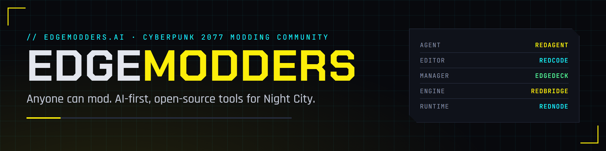
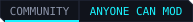
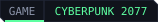

<p align="center">
  
</p>

<p align="center">
  <a href="https://edgemodders.ai/"></a>
  
  
</p>

The website for [edgemodders.ai](https://edgemodders.ai/), home of EDGEmodders: a new Cyberpunk 2077 modding community that brings AI to modding, so anyone can mod, not only people who already code.

The site pitches the EDGEmodders tools and links to their docs:

| Tool | Role | Docs |
|---|---|---|
| [REDagent](https://github.com/Edgemodders/REDagent) | Modding agent inside the game, powered by Claude | [edgemodders.github.io/REDagent](https://edgemodders.github.io/REDagent/) |
| [REDcode](https://github.com/Edgemodders/REDcode) | Modding IDE on VS Code | [edgemodders.github.io/REDcode](https://edgemodders.github.io/REDcode/) |
| [EDGEdeck](https://github.com/Edgemodders/EDGEdeck) | Mod manager | [edgemodders.github.io/EDGEdeck](https://edgemodders.github.io/EDGEdeck/) |
| [REDbridge](https://github.com/Edgemodders/REDbridge) | WolvenKit engine host over JSON-RPC (its MCP server is in REDcode) | [edgemodders.github.io/REDbridge](https://edgemodders.github.io/REDbridge/) |
| [REDnode](https://github.com/Edgemodders/REDnode) | Node.js runtime scripting | [edgemodders.github.io/REDnode](https://edgemodders.github.io/REDnode/) |
| [EDGEbuilder](https://github.com/Edgemodders/EDGEbuilder) | World builder inside the game, on REDnode | [edgemodders.github.io/EDGEbuilder](https://edgemodders.github.io/EDGEbuilder/) |
| [EDGEwave](https://github.com/Edgemodders/EDGEwave) | Sound studio beside REDcode (in development) | [edgemodders.github.io/EDGEwave](https://edgemodders.github.io/EDGEwave/) |
| [EDGEmat](https://github.com/Edgemodders/EDGEmat) | Material editor (planned) | [edgemodders.github.io/EDGEmat](https://edgemodders.github.io/EDGEmat/) |
| [EDGEkit](https://github.com/Edgemodders/EDGEkit) | The EDGEmodders editor and its extension pack | [edgemodders.github.io/EDGEkit](https://edgemodders.github.io/EDGEkit/) |

## Repository layout

| Path | Contents |
|---|---|
| `docs/index.html` | The landing page, standalone HTML in the HUD style |
| `docs/platform.html` | The EDGE platform page, standalone HTML sharing `docs/assets/css/site.css` with the landing page |
| `docs/wiki/` | The EDGEmodders wiki, rendered with `docs/_layouts/wiki.html` |
| `docs/*.md` | Further pages, rendered by Jekyll with `docs/_layouts/default.html` and `docs/assets/css/hud.css` |
| `docs/assets/tools/` | Tool icons, copied from each tool's `docs/assets/brand/icon.png` |
| `tools/brand/` | Generates the banner, social preview, icon and badges |

## Build and deploy

`.github/workflows/pages.yml` builds `docs/` with Jekyll and deploys it to GitHub Pages on every push to `main`.

One-time setup on GitHub:

1. Settings > Pages > Source: **GitHub Actions**.
2. Settings > Pages > Custom domain: `edgemodders.ai`, then tick **Enforce HTTPS** once the certificate is issued.
3. At the DNS provider for `edgemodders.ai`: `A` records for the apex to `185.199.108.153`, `185.199.109.153`, `185.199.110.153`, `185.199.111.153`, and a `CNAME` for `www` to `edgemodders.github.io`.
4. Settings > General > Social preview: upload `docs/assets/brand/social.png`.

Preview locally by opening `docs/index.html` in a browser. Markdown pages need Jekyll to render.

Regenerate the brand images:

```powershell
.\tools\brand\render.ps1
```

---

A fan community, not affiliated with or endorsed by CD PROJEKT RED. Cyberpunk 2077 is a trademark of CD PROJEKT S.A.
